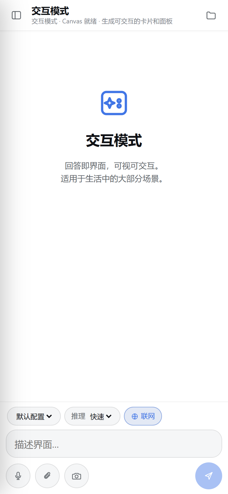
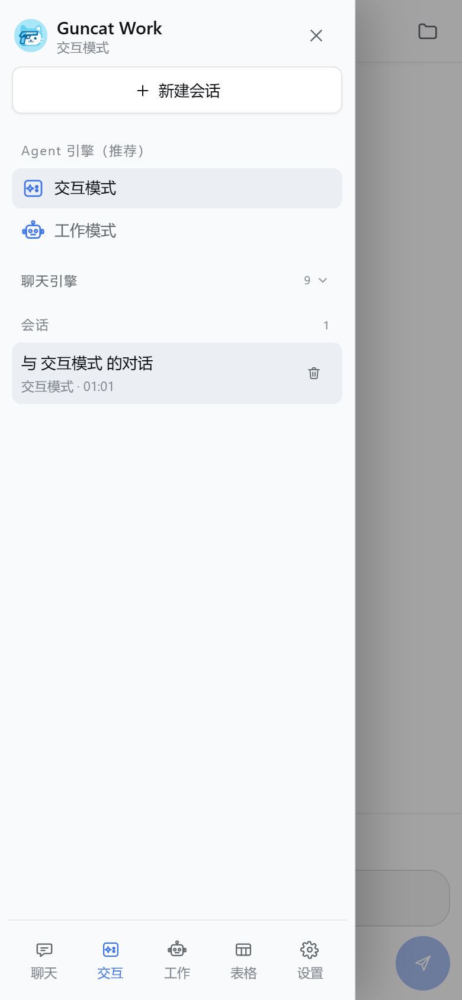
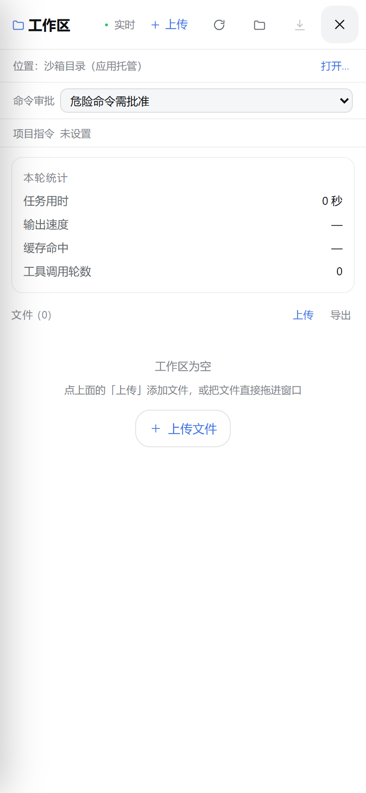
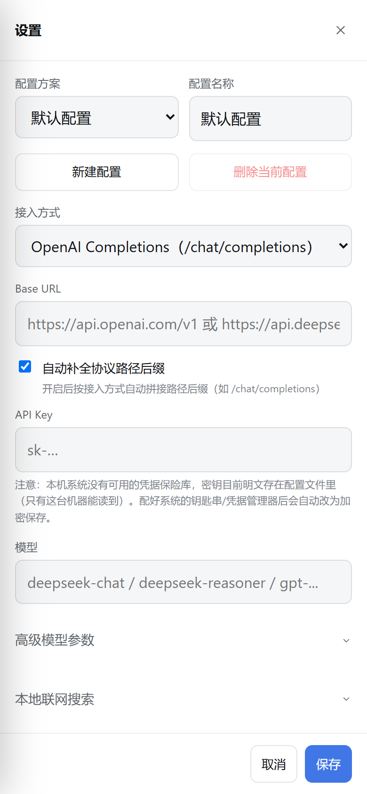

# Guncat Work (Android)

[中文](README.md) | [English](README_EN.md)

> Guncat Work's agent harness, ported to Android: **three conversation modes, three streaming
> provider protocols, a multi-round tool loop with a sandboxed workspace, interactive UI,
> Office output, and an auditable command path** — shipped as an APK.


[](LICENSE)

| Chat | Session drawer | Workspace |
| --- | --- | --- |
|  |  |  |

Settings and the workspace are full-screen pages on phones, not scaled-down desktop dialogs:



## Three modes

| Mode | Reference | On Android |
| --- | --- | --- |
| ✦ **Interactive** | GPT **Intelligent UI** | One prompt produces an operable UI; control values recompute immediately |
| 🛠 **Work** | **DeepSeek Harness** (Codex-style agent loop) | Multi-round tool loop + per-conversation sandbox + built-in tools |
| Chat | — | Plain conversation, no workspace |

All three share the same business core (`src/core/`) with the desktop build.

## What the Android port does

This is not a WebView wrapper around the Electron UI. Android has no Node main process, no
`/bin/sh`, and no writable install directory, so those layers were replaced:

| Desktop capability | Android implementation |
| --- | --- |
| Electron main process + preload IPC | **In-WebView host**: `SessionManager` runs inside the page; `window.guncat` keeps the exact preload signature, so the React UI is unchanged |
| Node `fs` | **memfs + IndexedDB persistence**: synchronous `fs` semantics retained; conversations, settings and workspace files survive restarts |
| Node `child_process` | **Built-in JS shell**: pipes, `&&`/`||`, redirections, file-oriented POSIX subset; Python/Node/git return an explicit "not supported" instead of pretending |
| Node `vm` for `run_js` | **Web Worker**: a timeout or infinite loop is really terminated |
| Electron dialogs | HTML file input (`onShowFileChooser`) + native download/share bridge |
| Electron `nativeImage` | `createImageBitmap` + canvas (resize, thumbnails, SVG rasterization) |
| Electron `shell.openPath` | MediaStore download, then system `ACTION_VIEW` / `ACTION_SEND` |
| Direct model API `fetch` | **Local same-origin reverse proxy on 127.0.0.1**: avoids WebView CORS and flushes SSE chunks as they arrive |
| Web Speech TTS | Android native `TextToSpeech`; voice input stays MediaRecorder + provider transcription |
| Desktop three-column layout | **Phone layout**: full-screen chat, left session drawer, composer chips, full-screen workspace/settings, safe areas, 44px touch targets |

### Mobile UI notes

- The top bar keeps only "drawer / title / workspace"; model, reasoning effort, thinking and web
  search become chips above the composer instead of a crowded top bar or an extra bottom sheet.
- The composer is two rows: the input, then voice / upload / camera / round send. Upload and camera
  automatically target chat attachments or the workspace depending on the mode.
- The sidebar is narrower (300px) and its bottom workspace entry is gone (the top-bar folder opens it
  directly); table extraction moved to the sidebar footer.
- The sidebar is a slide-over drawer that closes after selecting a conversation, engine or mode.
- The composer uses 16px text and a 46px minimum height; `adjustResize` keeps it above the keyboard.
- Markdown tables scroll horizontally; icon buttons are at least 40×40.
- Android back first closes drawers/dialogs/workspace, then requires a double press to exit.

## Install

1. Install `release/Guncat-Work-0.2.1-android.apk` (Android 10+; allow unknown sources).
2. Open **Settings → Provider**, fill Base URL, API Key and model, then save.
   Supported: OpenAI Completions, OpenAI Responses, Anthropic Messages (all with image input).
3. Use the chat. In work/interactive modes, files enter through **Workspace → Upload**; in chat
   mode use the paperclip.

## Build the APK

Requirements:

- Node.js 20+
- JDK 17+ (validated with 21/25)
- Android SDK `platforms/android-35` and `build-tools/35.0.0` (no Gradle required)
- SDK lookup: `ANDROID_HOME` → `ANDROID_SDK_ROOT` → `.android-sdk/` → `%LOCALAPPDATA%\Android\Sdk`

```bash
npm install
npm run dist:android
```

Output: `release/Guncat-Work-<version>-android.apk`

The script runs: Vite mobile build → copy `resources/` → `aapt2 compile/link` → `javac` →
`d8` → `zipalign` → `apksigner`. The first build creates a local signing key under
`android/keystore/`; keep it for future upgrades.

Front-end-only development:

```bash
npm run dev:android   # http://127.0.0.1:5174
```

Without `window.GuncatAndroid`, saving, system TTS and the streaming proxy degrade to browser
behavior. The APK is the source of truth for full capability.

## Built-in shell

`run_command` is adapted, not removed. It executes a POSIX subset inside the app sandbox workspace:

- Supported: `pwd` `cd` `ls` `cat` `head` `tail` `wc` `grep` `find` `sed` `mkdir` `rm` `cp` `mv`
  `touch` `stat` `sort` `uniq` `cut` `tr` `base64` `echo` `printf` `true` `false` `test` `date`
  `uname` `whoami` `env` `which` `sleep`
- Supported syntax: `|`, `&&`, `||`, `;`, `>`, `>>`, `<`, `2>`
- Not supported: `python`, `node`, `npm`, `git`, `curl`, `wget`, `ffmpeg`, `libreoffice`, `pandoc`, …
  These return exit code 127 with an explicit explanation and the list of available commands.

File organization, text search/editing and workspace analysis work entirely on-device; heavy
Python/Office CLI pipelines still belong on the desktop. This is a platform boundary, not a TODO.

## Capability matrix

| Capability | Android |
| --- | --- |
| Streaming chat, reasoning, web search | ✅ |
| Work-mode agent loop, 45 tools, skills | ✅ (command tools use the built-in shell) |
| Interactive UI rendering | ✅ |
| Office generation (docx/xlsx/pptx/svg) | ✅ saved to `Downloads/Guncat Work` |
| Image viewing / thumbnails / SVG rasterization | ✅ |
| Chat attachments + workspace upload | ✅ system file picker |
| Table extraction (vision model) | ✅ |
| Read-aloud | ✅ system TTS |
| Voice input | ✅ MediaRecorder + provider transcription |
| Persistence | ✅ IndexedDB (app-private, removed on uninstall) |
| PDF parsing / page rendering | ⚠️ backend not ported yet; tools return a clear "backend unavailable" |
| Custom workspace directory | ⚠️ not supported; use the app sandbox and ZIP export |
| "Reveal in file manager" | ⚠️ replaced by save/share to Downloads |
| Long background tasks | ⚠️ WebView may be frozen in background; keep the app in foreground |

## Layout

```text
src/core/        shared business core (no platform code)
src/main/        Electron main process (desktop)
src/renderer/    React UI (shared)
src/mobile/      Android host: boot, window.guncat host, browser kits, shims, shell, native bridge
android/         Java WebView shell, local server/proxy, resources, keystore
```

## Verification

Browser smoke tests (Edge/Chrome at 390×844) cover: first paint, drawer, quick-settings sheet,
full-screen settings; save config → create conversation → mocked SSE streaming → reload persistence;
work mode tool call (`run_command` → built-in shell → result → final answer); shell pipes and
redirections; unsupported-command 127; `run_js` input/output and worker timeout; plus
`npm run typecheck` across node/web/mobile.

## Privacy

- Data lives in app-private IndexedDB; only explicit exports reach Downloads.
- API keys are stored in app-private config in plaintext (no desktop-style OS credential vault);
  the settings UI says so.
- Model requests are forwarded through a loopback-only proxy guarded by a per-launch random token.

## Known limitations

1. PDF parsing backend is not ported yet.
2. The built-in shell is not a full Linux userland.
3. Background execution is not guaranteed (no foreground service).
4. No custom workspace directory and no system "open with" intake.

## Docs

- [Android porting notes](docs/ANDROID.md)
- [Desktop ↔ HarmonyOS porting archive](docs/PORTING.md)
- [Changelog](CHANGELOG.md)

## License

[Apache-2.0](LICENSE)
