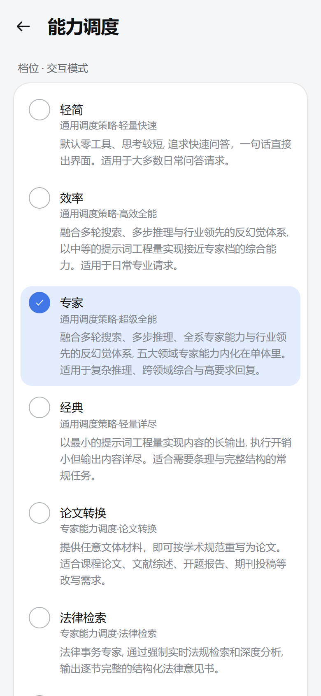

# 交互模式（Intelligent UI）实现说明

> 对齐 GPT 的 Intelligent UI：**一句话进来，一张能操作的界面出去**。
> 模型不再回纯文本，而是回一份**界面程序**，客户端把它渲染成原生可交互界面。

## 1. 数据流全景

```text
用户：一句话
  └─ 主进程 SessionManager.runWork(mode='interactive')
       ├─ AgentLoopService.buildWorkSystemPromptFor('interactive')
       │    （行为纪律：默认零工具、一轮直出；工具面物理裁剪 45 → 27）
       │    （末尾再追加当前交互模式生效的个性化指令段，见 docs/PERSONAL-INSTRUCTIONS.md）
       └─ 模型流式输出 guncat-ui lang 程序
            └─ 逐 token 推给渲染进程（message:patched 事件）
                 └─ 渲染进程 MessageView
                      ├─ GuncatUiParts.build(content)  ── 拆成 文本片段 / 界面片段
                      ├─ 文本片段 → Markdown 组件
                      └─ 界面片段 → GuncatUiBlock
                           ├─ GuncatUiLang.parse(source)    解析成语句 + AST
                           ├─ GuncatUiState.of(program, saved)  绑定值（含尾标记恢复）
                           ├─ GuncatUiLang.render(program, values)  按当前绑定值物化元素树
                           └─ renderNode(root) → React 组件树（76 个组件）
```

**用户操作回流**（拖动滑块 / 点按钮）：

```text
控件 onChange
  ├─ 本地动作（@Set / @Reset）→ 改 GuncatUiState → 重新物化并重渲染（不发请求、不等模型）
  ├─ 绑定值变化 → 去抖 400ms → 以尾标记写回消息 → IPC 持久化（滚动/切会话/重启后仍在）
  └─ 回传动作（@ToAssistant）→ 组装成用户消息发回模型 → 模型产出更新后的完整界面
```

下一轮请求前，主进程会把上一轮界面的绑定状态翻译成一句人话
（`GuncatUiRuntime.describeStateForModel`）附在任务后面，
模型因此始终知道界面当前处于什么状态。

## 2. 与鸿蒙版的分工

**零改动的部分**（直接从上游移植，纯逻辑、无平台依赖）：

| 模块 | 职责 |
| --- | --- |
| `GuncatUiLang.ts` | 词法 / 语法 / 自动补全括号 / 物化求值 / 围栏切分 |
| `GuncatUiLibrary.ts` | 76 个组件的签名与位置参数表（**单一事实源**：同时驱动提示词、解析、渲染合法性） |
| `GuncatUiRuntime.ts` | `$绑定`状态、动作执行、控件取值、状态尾标记、回传给模型的人话描述 |
| `GuncatUiParts.ts` | 把消息正文切成「Markdown 文本片段 + 界面程序片段」 |
| `GuncatUiPaint.ts` | 图表几何（比例尺 / 路径生成 / 雷达 / 楔形）、调色板、数值格式化 |
| `GuncatUiPrompt.ts` | 交互模式系统提示词 |

**桌面端新写的部分**（把 ArkUI 的「画」换成 DOM + SVG）：

| 文件 | 职责 |
| --- | --- |
| `renderer/src/guncat-ui/GuncatUiBlock.tsx` | 顶层块：解析、持有绑定值、重物化、状态回写、只读态 |
| `renderer/src/guncat-ui/nodes.tsx` | 元素树 → React 组件树的分派器（覆盖全部 76 个组件） |
| `renderer/src/guncat-ui/charts.tsx` | 8 种图表用 SVG 绘制，几何复用 `GuncatUiPaint` |
| `renderer/src/guncat-ui/guncat-ui.css` | 与主应用共用 CSS 变量，深浅色自动适配 |

> 上游 `views/GuncatUiView.ets`(2807 行) + `GuncatUiCharts.ets` + `GuncatUiIcons.ets`
> 合计约 3900 行 ArkUI，在桌面端由约 1300 行 React 等价表达。

## 3. 组件覆盖

76 个组件按 9 组全部实现：

| 分组 | 数量 | 代表 |
| --- | --- | --- |
| 根与内容 | 15 | `Card` / `CardHeader` / `TextContent` / `MarkDownRenderer` / `Callout` / `CodeBlock` / `ImageGallery` / `EntityList` |
| 布局 | 9 | `Tabs` / `Accordion` / `Steps` / `Carousel` / `SectionBlock` |
| 表格与数据 | 2 | `Table` / `Col` |
| 图表 | 8 | `BarChart` / `LineChart` / `AreaChart` / `HorizontalBarChart` / `PieChart` / `RadialChart` / `SingleStackedBarChart` / `Series` |
| 指标与文本 | 6 | `Text` / `IconText` / `ImageText` / `MetricIndicatorInline` |
| 卡片块 | 10 | `OverviewCardBlock` / `SnippetCardBlock` / `ContextCardBlock` / `CompositeCardBlock` / `VisualCardBlock` |
| 列表与追问 | 4 | `ListBlock` / `FollowUpBlock` |
| 表单 | 18 | `Form` / `FormControl` / `Slider` / `Select` / `RadioGroup` / `CheckBoxGroup` / `SwitchGroup` / `Chips` / `OptionCards` / `DatePicker` |
| 按钮与图标 | 4 | `Button` / `Buttons` / `IconButton` / `Icon` |

> 组件清单不是手抄的，而是用 `pnpm dump:components` 从 `GuncatUiLibrary` 直接导出，
> 保证「模型看到的」= 「我们解析的」= 「我们能画的」三者一致。

## 4. 容错设计（继承上游并保留）

| 情形 | 行为 |
| --- | --- |
| 流式中间态（括号未闭合） | `UiAutoClose` 自动补齐，**已写完的语句全部保留**（这也是相对「输出一大段 JSON」最根本的改进：JSON 一截断就整块作废） |
| 引用了还没流进来的变量 | 暂时为空，等定义流进来再出现 |
| 未知组件名 | **丢弃该组件并给出诊断**，但同块的其它组件照常渲染 |
| 必需参数缺失 / 类型不符 | **不丢弃组件**，用安全默认值渲染 —— 聊天场景里「少一个字段」远好于「整块消失」 |
| 未知组件在渲染期到达 | 渲染器兜底：把它的文本参数与子元素尽量显示出来并标注 |

## 5. 验证

交互模式有两层无头验证，都不依赖 Electron 窗口：

```bash
npm run smoke:core     # core 全链路（数量随断言增长；含第 23 组「能力调度」九档断言）
npm run smoke:render   # React SSR 渲染断言
```

`smoke:core` 第 13 组覆盖：程序解析、入口解析、`$变量`收集、表达式求值、
**改绑定值后表达式重算**、派生表达式同步更新、`@ToAssistant` 动作收集、
状态尾标记往返、文本/程序混合拆分、表单字段打包回传、图表 labels/series 提取、
未闭合程序容错、未知组件诊断。

`smoke:render` 用 `react-dom/server` 把一份覆盖主要组件的界面程序渲染成 HTML，
逐项断言卡片标题、`$绑定`求值结果、指标卡、趋势方向、滑块默认值、图表 SVG 与图例、
表格、选项卡、折叠面板、步骤条、标签、Callout 变体、代码块、饼图、键值清单、
表单与下拉框、只读态置灰标记，以及**正文与界面共存**的组合关系。

## 6. 能力调度（交互模式提示词档位）

交互模式默认用一份「为快而生」的快车道提示词；**能力调度**让用户按任务需要，把聊天
引擎里八份成熟智能体提示词作为「档位主体」挂进交互模式。交付形态不随档位变化：无论
哪一档，回答主体都是一份 `guncat-ui lang` 界面程序、程序之外不写文字；档位改变的是
专业内容与流程的厚度。



- **入口**：设置 →「能力」→「能力调度」，九档单选，默认「轻简」；选择持久化在
  `guncat_interactive_tier`。
- **九档**（按能力由轻到重）：轻简 / 效率 / 专家 / 经典 / 论文转换 / 法律检索 /
  深度研究 / 信息筛滤 / LLM评估。各档的定位、移植来源、推荐思考强度与工具面见下表。

| # | 档位 | 定位 | 移植来源 | 推荐思考 | 工具面 |
| ---: | --- | --- | --- | --- | ---: |
| 1 | 轻简 | 通用调度策略·轻量快速 | —（原交互模式提示词，逐字节复用） | `low` | 27 |
| 2 | 效率 | 通用调度策略·高效全能 | `Guncat 3.0-Flash_prompt_ZH_CN.md` | `low` | 28 |
| 3 | 专家 | 通用调度策略·超级全能 | `Guncat 3.0-Pro_prompt_ZH_CN.md` | `high` | 29 |
| 4 | 经典 | 通用调度策略·轻量详尽 | `Guncat 2.5-lite _prompt.md` | `high` | 28 |
| 5 | 论文转换 | 专家能力调度·论文转换 | `Guncat Cnvt-Paper_prompt.md` | `low` | 27 |
| 6 | 法律检索 | 专家能力调度·法律检索 | `Guncat Srch-Law V1.0-prompt.md` | `high` | 29 |
| 7 | 深度研究 | 专家能力调度·深度研究 | `Guncat Srch-Research-prompt.md` | `high` | 29 |
| 8 | 信息筛滤 | 专家能力调度·信息筛滤 | `Guncat Srch-Sift-prompt.md` | `high` | 28 |
| 9 | LLM评估 | 专家能力调度·LLM评估 | `Guncat Eval-LLM_prompt.md` | `high` | 29 |

选一个档位，实际决定三件事：

- **系统提示词**：共享层（界面语言契约 / 丰富度 / 环境 / 职责）＋该档的档位主体。
  八档的主体是从聊天引擎迁入的成熟提示词；轻简档没有主体文件，它就是原交互模式
  提示词本身。
- **工具面**：基础 27 个工具不变；检索 / 多阶段档位在其上追加 `record_search` /
  `todo_write`，长程维护类工具（`goal_*` / `schedule_*` / `session_search` / `subagent`
  等）在任何档位都不下发。
- **推荐思考强度**：切档时把交互模式的思考强度同步到该档推荐值（`low` / `high`），
  之后仍可在模型弹层手动改，不锁死。

三条边界：

- **只影响交互模式**：`AgentLoopService.buildWorkSystemPromptFor(mode, tierId)` 与
  `toolDefsForMode(mode, ...)` 只在 `mode === 'interactive'` 时使用档位；工作模式与聊天
  模式的系统提示词、工具面不受影响。
- **下一个任务生效**：每次任务开始时从偏好重新读档位并规范化（空值 / 旧值 / 脏值回退
  轻简）；系统提示词与工具面按档位在进程内缓存，切档不改写历史。
- **缺主体不崩**：档位主体 md 缺失或为空时，`buildInteractiveSystemPrompt()` 回退轻简
  档，不会交付一份没有业务主体的「空壳档位」提示词。

### 6.1 分层组装

系统提示词由 `InteractiveTierPrompt` 单一事实源按固定顺序拼成；轻简档的每一段复用原
实现（`PromptBuilder` / `GuncatUiPrompt`），其余八档在同一骨架上按档参数化：

| 顺序 | 层 | 来源 | 轻简 | 其余八档 |
| ---: | --- | --- | --- | --- |
| ① | 档位声明 | `PromptBuilder.interactivePrime()` / `InteractiveTierPrompt.tierPrime()` | 原文（唯一一级标题 + 第一纪律） | 按档生成（身份 / 第一纪律 / 工具与思考政策 / 丰富度口径） |
| ②~⑨ | 界面语言契约（共享层） | `GuncatUiPrompt` + `GuncatUiLibrary` | 原文 | 原文（仅丰富度数量口径按档替换） |
| ⑩ | 档位主体 | `resources/interactive-tier-*.md` | 无 | 该档主体（角色 / 思维链 / 工作流 / 反幻觉 / 模板 / 知识库） |
| ⑪~⑭ | 环境与工具底座 | `InteractiveTierPrompt` + `WorkSkillService` | 快车道口径（素材区） | 素材区 + 产出区、本档工具面、真实数据纪律、技能极小索引 |
| ⑮~⑯ | 起手式 + 交付形态职责 | `InteractiveTierPrompt` | 原文 | 档位版（程序之外不写文字 / 冲突裁决） |

> 轻简档没有第 ⑩ 段「档位主体」，实际只有 15 段；其余八档均为 16 段。

- 顺序本身就是设计：**纪律在最前**（契约段包含很长的组件清单，纪律写后面等于没写），
  界面语言契约随后先立规矩，档位主体居中，环境与工具靠后，职责收尾并给出回到开头的
  指针。
- 档位主体是 `resources/` 下的 markdown，启动时由 `AgentLoader.loadInteractiveTierPrompts()`
  读入内存（`InteractiveTierPrompts`），之后系统提示词走进程内缓存，保持相邻轮次的
  KV 缓存前缀稳定。
- 轻简档的组装结果与旧四段组装（`PromptBuilder.interactivePrime()` +
  `GuncatUiPrompt.promptSection()` + `PromptBuilder.buildInteractive()` +
  `GuncatUiPrompt.INTERACTIVE_DUTY`）**逐字节一致**，由 `scripts/smoke.ts` 与
  `scripts/dump-interactive-tiers.mjs` 双重断言钉住——「轻简 = 直接用现有交互模式
  提示词」是事实而不是承诺。

### 6.2 迁移原则与可核对材料

八档主体从聊天引擎提示词移植，改动只发生在与交互模式事实冲突的锚点上：

- **主体逐字保留**：角色定义、思维链、执行模式、工具方法论、反幻觉体系、领域工作流、
  输出模板与知识库全部保留；只删原文的第一个标题型 H1（H1 由档位声明承担），其余 H1
  降为 H2。
- **只做交付形态适配**：文字用界面组件承载、mermaid 由界面分层替代、确认参数改界面
  表单、平台工具映射为交互模式真实工具。所有改动带「交互模式适配」标注，可 `grep`
  审计。
- **共享层不重复原文**：界面语法、组件清单、工作区规则、工具白名单、组件数量口径只写
  在共享层；档位主体只承担业务灵魂。
- **轻简不迁移**：轻简就是原交互模式提示词本身，保证默认档行为与速度不变。

完整说明与九档组合后的完整系统提示词：

- [交互模式能力调度提示词适配说明](prompts/interactive-tier-adaptation.md)
- [九档完整提示词导出](prompts/interactive-tiers/README.md)（`node scripts/dump-interactive-tiers.mjs` 重新生成）
